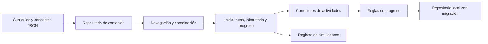

# Arquitectura

TeslaCode conserva una aplicación estática de módulos ES. El catálogo se carga al iniciar; las lecciones y simuladores, bajo demanda. Pyodide solo se descarga al ejecutar un ejemplo o una actividad Python.

## Responsabilidades

- **Repository:** `content-repository.js` oculta fetch, cachea resultados y permite reintentar cargas fallidas. `core/storage.js` concentra persistencia, normalización y migración; puede sustituirse por un adaptador sincronizado.
- **Strategy:** `domain/grading.js` corrige selección, secuencias y respuestas abiertas normalizadas. Un nuevo tipo exige corrector, vista, validación y pruebas.
- **Ejecución Python:** `features/activities.js` selecciona `code-activity.js` para `type: python`. La misma vista monta consolas junto a los ejemplos declarados de la etapa Aprender. Usa el contrato `run/cancel/dispose` de `repositories/python-runner.js`; el corrector compartido y la validación del ejercicio viven en `domain/python-exercise.js`. El adaptador es inyectable en las pruebas de interfaz.
- **Registro de componentes:** `widgets/index.js` selecciona simuladores mediante identificadores y carga diferida.
- **Dominio puro:** `curriculum.js`, `progress.js`, `gamification.js` y `runner.js` no conocen el DOM. Se prueban con el runner de Node.
- **Presentación:** las vistas reciben estado y generan interfaz. `main.js` coordina navegación y persistencia mediante callbacks explícitos. No hace falta un bus de eventos mientras exista un solo coordinador de estas operaciones.

## Navegación y concurrencia

Las URLs por fragmento representan la vista, ruta, lección y etapa. Todos los accesos a una lección comprueban el estado publicado y los pasos previos de su propia ruta, incluso si se escribe la URL directamente. `accessState` centraliza el estado y separa requisitos internos de referencias académicas transversales. El token de render evita que una carga anterior reemplace una vista más reciente. Un cambio de ruta desmonta el contenido anterior completo.

Los requisitos son referencias de lección `ruta/id`. `schemaVersion: 2` separa `progressionRequires` (pasos obligatorios de la propia ruta) de `dependsOn` y `requiresConcepts` (conocimientos utilizados). `dependencyRationale` explica por qué se necesitan. La vista muestra ambas relaciones por separado. Un laboratorio opcional no bloquea el núcleo, y `nextLesson` prioriza el siguiente paso principal. El validador rechaza pasos externos, posteriores, omitidos o en preparación; también comprueba el grafo académico. Las lecciones completadas del formato anterior conservan su acceso.

## Persistencia

La versión 2 mantiene XP, racha, finalizaciones, prácticas, recompensas concedidas, favoritos, último acceso, objetivo y preferencia de acompañamiento (`guided` o `experienced`). La normalización incorpora esta preferencia sin cambiar el esquema v2 ni perder logros. Los últimos 20 intentos de cada lección permiten mostrar dificultades; la mejor puntuación permite reconocer avances anteriores. Las rachas usan el día local, no UTC.

La migración conserva los logros anteriores y no inventa resultados de preguntas. El progreso local es editable por su propietario: no constituye una certificación verificable. No almacena secretos ni llama a modelos remotos.

`progress-backup.js` valida copias v1/v2 de hasta 2 MiB y combina logros mediante conjuntos e intentos deduplicados. El XP se obtiene de recompensas únicas y el mayor remanente antiguo sin desglose, evitando sumar dos veces una copia. `progress-import.js` muestra la vista previa y guarda los estados anterior y combinado antes de aplicar. Deshacer restaura la copia solo si desde la importación no cambiaron logros, intentos ni favoritos: así no elimina avances posteriores. Un fallo de persistencia conserva el estado activo. Los borradores usan claves separadas por lección/actividad y no forman parte de la exportación.

## Ejecución y texto

El intérprete educativo analiza una gramática limitada, sin `eval`, `Function`, acceso a red o bucles. Limita longitud, líneas, operaciones inválidas y resultados no finitos. La segmentación de texto no se presenta como tokenización comercial; la señal/ruido es una interpolación ilustrativa, no difusión neuronal.

El contenido HTML pertenece al repositorio y pasa por validación. El texto introducido por estudiantes, resultados de búsqueda y metadatos se escapan antes de insertarse como HTML. El validador no sustituye un sanitizador para un futuro editor público: ese producto requeriría otra frontera de confianza.

La ejecución Python crea un iframe con `sandbox="allow-scripts"`, sin origen compartido, y un Worker dentro de ese marco. Su CSP limita scripts y red a la distribución fijada y blobs necesarios. Cada solicitud verifica marco de origen y canal; no expone el DOM ni el almacenamiento de TeslaCode al código del estudiante. Navegar, detener o agotar el tiempo destruye el marco y su Worker. Cada ejecución inicia un runtime nuevo; los casos reciben un espacio de nombres nuevo.

`mode: run` ejecuta el programa con las entradas que el estudiante escribe antes de comenzar. No invoca automáticamente una función del ejercicio ni concede créditos. El modo de comprobación conserva los casos del autor y es el único que llama al callback de resolución. Ambos devuelven `stdout`, también al fallar; el resultado devuelto por una función se presenta por separado. La consola escribe texto mediante `textContent` y muestra la línea del código del estudiante en las excepciones. Durante una ejecución libre, el adaptador comunica salida parcial como máximo cada 50 ms; detener o agotar el tiempo conserva la salida recibida.

Los ejemplos reutilizan el editor, consola y ciclo de cancelación sin controles de evaluación. Se enlazan por el código declarado y visible; la validación editorial comprueba esa coincidencia. `environment: local` presenta instrucciones en lugar de iniciar un motor incompatible. Leer una lección o abrir estos paneles no inicia Python.

Límites actuales: 12.000 caracteres de código, 20 casos, 6.000 caracteres de salida por caso, 45 segundos para cargar y 3 segundos para ejecutar el conjunto. No hay una cuota dura de memoria. El espacio de nombres por caso no constituye aislamiento del sistema de archivos entre casos; ejercicios futuros que lo usen necesitan un contrato adicional. Threads, procesos, sockets y paquetes nativos no tienen las mismas capacidades en WebAssembly. Los tests del cliente son visibles y sirven para aprendizaje, no para certificación resistente a manipulación.

## Evolución

Una cuenta sincronizada, servicios de backend, cómputo que exceda las capacidades del navegador o APIs con secretos necesitan otra infraestructura. Los ejercicios actuales de biblioteca estándar no requieren backend. Las credenciales de proveedores deben quedar fuera del cliente. La arquitectura permite agregar adaptadores sin mezclar contenidos con transporte o persistencia.

## Presentación y apoyos

`activities.js` contiene la interacción reutilizada por prácticas y repasos. `learning-support.js` presenta los conceptos transversales y la orientación de tres preguntas. Estas consultas no registran intentos de curso, finalizaciones o XP. La orientación permite elegir acompañamiento y comenzar el siguiente paso disponible.

Las capas `experience.css` y `studio.css` organizan las vistas de aprendizaje y la portada de trabajo, respectivamente. `studio.js` presenta hitos reales y un laboratorio; `playground.js` calcula sus transformaciones locales sin otorgar créditos de curso. La computadora combina una ilustración WebP con controles HTML y lluvia de código CSS confinada a la pantalla; no ejecuta lenguajes arbitrarios. Las animaciones se pueden pausar y respetan movimiento reducido. El tema oscuro es el predeterminado y se conserva la selección de tema del usuario.

## Coherencia entre ediciones

`practice.css` contiene los estilos del editor y sus resultados; no aumenta el archivo general de componentes. La auditoría de reglas CSS heredadas sigue pendiente.

El índice versiona todo el grafo ES mediante un import map, junto con estilos, contenido e imágenes. Las consultas JSON conservan su caché de promesas en memoria, usan URLs de la edición y evitan la caché HTTP. La prueba con caché previa verifica actualización y conservación del progreso. Consulta `docs/release-coherence.md`.
