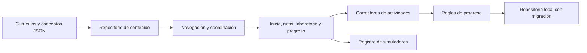

# Arquitectura

## Tutor opcional con Gemini

La web conserva módulos ES y aprendizaje estático. `tutor-launcher.js` se monta en la estructura permanente, pero importa el panel, su cliente y su CSS únicamente al abrirlo. `tutor-chat.js` mantiene conversaciones acotadas en memoria por lección; no accede al repositorio de progreso ni persiste el chat. El código solo se comparte por una acción explícita. Al cerrar, cambiar de ruta o desmontar se cancela la solicitud; las escenas de profundidad se pausan mientras el diálogo está abierto.

`api/tutor.mjs` adapta la función de Vercel al handler Web Standard de `server/tutor/`. El servidor valida origen, tamaño, esquema, roles y contexto. Selecciona explicaciones publicadas de un índice privado generado, reserva una consulta mediante cuotas compartidas y conecta con Gemini por REST; la clave viaja solo entre servidor y proveedor. Devuelve metadatos de lecturas verificadas, fragmentos de texto y un cierre explícito mediante SSE. No ofrece herramientas, ejecución o mutaciones del progreso al modelo.

La cuota de producción usa una operación atómica de Redis con límites de minuto, día por conexión y día global; un fallo impide llamar al modelo. En local se utilizan contadores en memoria. El paquete `dist/` se construye con una lista de archivos públicos y rechaza enlaces simbólicos; excluye claves, servidor y herramientas. El servidor local sirve ese paquete y la misma API. Vercel tiene habilitada la cancelación por ruta. Consulta [configuración, privacidad y límites](tutor-gemini.md).

## Atmósfera global e introducción

`main.js` monta una única instancia de `features/atmosphere.js` sobre la estructura permanente de `index.html`; la navegación por fragmentos no remonta el video. `pagehide` libera listeners, observadores y decodificador; `pageshow` con restauración vuelve a montar el controlador. El fondo WebP y los símbolos SVG/CSS comparten la escena fija; solo la navegación fija aplica desenfoque. Las consolas conservan superficies legibles.

El diálogo nativo de introducción carga el MP4 y su cartel únicamente al comenzar. `sessionStorage` registra que se vio, con respaldo en memoria si el almacenamiento falla; no escribe progreso ni XP. Reproduce automáticamente solo en el inicio y con movimiento permitido; pausa en pestañas ocultas y ofrece pausa, sonido, omitir y repetición. Al finalizar libera `src` y `poster` después del fundido. Si el video se interrumpe tras comenzar, espera su continuación sin un corte por tiempo de reproducción.

La animación interactiva actúa sobre el propio Tesla del fondo. `tesla-world.js` carga el renderizador, un fondo auxiliar y una máscara únicamente tras un movimiento de ratón compatible. Reutiliza la fotografía existente para el rostro. En la portada el encuadre se ancla a la escena del documento y deja libre la cabeza completa; en otras vistas acompaña el viewport bajo la cabecera. Las siete rutas siguen accesibles en HTML.

TeslaCode conserva una aplicación estática de módulos ES. El catálogo se carga al iniciar; las lecciones y simuladores, bajo demanda. Pyodide solo se descarga al ejecutar un ejemplo o una actividad Python.

## Responsabilidades

- **Repository:** `content-repository.js` oculta fetch, cachea resultados y permite reintentar cargas fallidas. `core/storage.js` concentra persistencia, normalización y migración; puede sustituirse por un adaptador sincronizado.
- **Strategy:** `domain/grading.js` corrige selección, secuencias y respuestas abiertas normalizadas. Un nuevo tipo exige corrector, vista, validación y pruebas.
- **Ejecución Python:** `features/activities.js` selecciona `code-activity.js` para `type: python`. La misma vista monta consolas junto a los ejemplos declarados de la etapa Aprender. Usa el contrato `run/cancel/dispose` de `repositories/python-runner.js`; el corrector compartido y la validación del ejercicio viven en `domain/python-exercise.js`. El adaptador es inyectable en las pruebas de interfaz.
- **Registro de componentes:** `widgets/index.js` selecciona simuladores mediante identificadores y carga diferida.
- **Dominio puro:** `curriculum.js`, `progress.js`, `gamification.js` y `runner.js` no conocen el DOM. Se prueban con el runner de Node.
- **Presentación:** las vistas reciben estado y generan interfaz. `main.js` coordina navegación y persistencia mediante callbacks explícitos. No hace falta un bus de eventos mientras exista un solo coordinador de estas operaciones.

## Navegación y concurrencia

Las URLs por fragmento representan la vista, ruta, lección y etapa. Todos los accesos a una lección comprueban el estado publicado y los pasos previos de su propia ruta, incluso si se escribe la URL directamente. `accessState` centraliza el estado y separa requisitos internos de referencias académicas transversales. El token de render evita que una carga anterior reemplace una vista más reciente. Un cambio de ruta desmonta el contenido anterior completo.

Los requisitos son referencias de lección `ruta/id`. `schemaVersion: 2` separa `progressionRequires` (pasos obligatorios de la propia ruta) de `dependsOn` y `requiresConcepts` (conocimientos utilizados). `dependencyRationale` explica por qué se necesitan. La vista muestra ambas relaciones por separado. Un laboratorio opcional no bloquea el núcleo, y `nextLesson` prioriza el siguiente paso principal. El validador rechaza pasos externos, posteriores, omitidos o en preparación; también comprueba el grafo académico. Las lecciones completadas del formato anterior conservan su acceso.

## Persistencia

La versión 2 mantiene XP, racha, finalizaciones, prácticas, recompensas concedidas, favoritos, último acceso, objetivo y preferencia de acompañamiento (`guided` o `experienced`). La normalización incorpora esta preferencia sin cambiar el esquema v2 ni perder logros. Los últimos 20 intentos de cada lección permiten mostrar dificultades; la mejor puntuación permite reconocer avances anteriores. Las rachas usan el día local, no UTC.

La migración conserva los logros anteriores y no inventa resultados de preguntas. El progreso local es editable por su propietario: no constituye una certificación verificable. No almacena secretos ni llama a modelos remotos.

Las escrituras usan un Web Lock del mismo origen cuando el navegador lo admite. Dentro del bloqueo, el repositorio vuelve a leer el progreso y combina logros e intentos de otras pestañas sin duplicar XP. Las preferencias y altas/bajas de favoritos se comparan con la última lectura de esa pestaña. Los eventos de almacenamiento actualizan el estado y los indicadores sin desmontar una lección activa. Sin Web Locks se conserva la combinación antes de escribir, aunque no se garantiza atomicidad entre escrituras simultáneas. Una importación o su deshacer exige que el estado almacenado siga coincidiendo con el esperado antes de reemplazarlo. La normalización pura vive en `domain/progress-state.js` y `core/storage.js` conserva sus exportaciones anteriores.

`progress-backup.js` valida copias v1/v2 de hasta 2 MiB y combina logros mediante conjuntos e intentos deduplicados. El XP se obtiene de recompensas únicas y el mayor remanente antiguo sin desglose, evitando sumar dos veces una copia. `progress-import.js` muestra la vista previa y guarda los estados anterior y combinado antes de aplicar. Deshacer restaura la copia solo si desde la importación no cambiaron logros, intentos ni favoritos: así no elimina avances posteriores. Un fallo de persistencia conserva el estado activo. Los borradores usan claves separadas por lección/actividad y no forman parte de la exportación.

## Ejecución y texto

El intérprete educativo analiza una gramática limitada, sin `eval`, `Function`, acceso a red o bucles. Limita longitud, líneas, operaciones inválidas y resultados no finitos. La segmentación de texto no se presenta como tokenización comercial; la señal/ruido es una interpolación ilustrativa, no difusión neuronal.

El contenido HTML pertenece al repositorio y pasa por validación. El texto introducido por estudiantes, resultados de búsqueda y metadatos se escapan antes de insertarse como HTML. El validador no sustituye un sanitizador para un futuro editor público: ese producto requeriría otra frontera de confianza.

La ejecución Python crea un iframe con `sandbox="allow-scripts"`, sin origen compartido, y un Worker dentro de ese marco. Su CSP limita scripts y red a la distribución fijada y blobs necesarios. Cada solicitud verifica marco de origen y canal; no expone el DOM ni el almacenamiento de TeslaCode al código del estudiante. Navegar, detener o agotar el tiempo destruye el marco y su Worker. Cada ejecución inicia un runtime nuevo; los casos reciben un espacio de nombres nuevo.

`mode: run` ejecuta el programa con las entradas que el estudiante escribe antes de comenzar. No invoca automáticamente una función del ejercicio ni concede créditos. El modo de comprobación conserva los casos del autor y es el único que llama al callback de resolución. Ambos devuelven `stdout`, también al fallar; el resultado devuelto por una función se presenta por separado. La consola escribe texto mediante `textContent` y muestra la línea del código del estudiante en las excepciones. Durante una ejecución libre, el adaptador comunica salida parcial como máximo cada 50 ms; detener o agotar el tiempo conserva la salida recibida.

Los ejemplos reutilizan el editor, consola y ciclo de cancelación sin controles de evaluación. Se enlazan por el código declarado y visible; la validación editorial comprueba esa coincidencia. `environment: local` presenta instrucciones en lugar de iniciar un motor incompatible. Leer una lección o abrir estos paneles no inicia Python.

Límites actuales: 12.000 caracteres de código, 20 casos, 6.000 caracteres de salida por caso, 45 segundos para cargar y 3 segundos para ejecutar el conjunto. No hay una cuota dura de memoria. El espacio de nombres por caso no constituye aislamiento del sistema de archivos entre casos; ejercicios futuros que lo usen necesitan un contrato adicional. Threads, procesos, sockets y paquetes nativos no tienen las mismas capacidades en WebAssembly. Los tests del cliente son visibles y sirven para aprendizaje, no para certificación resistente a manipulación.

## Evolución

Una cuenta sincronizada, servicios de backend, cómputo que exceda las capacidades del navegador o APIs con secretos necesitan otra infraestructura. Los ejercicios actuales de biblioteca estándar no requieren backend. Las credenciales de proveedores deben quedar fuera del cliente. La arquitectura permite agregar adaptadores sin mezclar contenidos con transporte o persistencia.

## Presentación y apoyos

`activities.js` contiene la interacción reutilizada por prácticas y repasos. `learning-support.js` presenta los conceptos transversales y la orientación de tres preguntas. Estas consultas no registran intentos de curso, finalizaciones o XP. La orientación permite elegir acompañamiento y comenzar el siguiente paso disponible.

Las capas `experience.css` y `studio.css` organizan las vistas de aprendizaje y la identidad visual del estudio de exploración. `studio.js` presenta hitos reales, un laboratorio y una escena CSS 3D con botones nativos para las siete rutas; `playground.js` calcula las transformaciones locales sin otorgar créditos de curso. El laboratorio mantiene sus entradas, pestañas y resultados como HTML legible; el inicio no ejecuta lenguajes arbitrarios ni inicia Pyodide.

`depth-scene.js` limita el movimiento a las capas decorativas. Agrupa los eventos del puntero en una sola actualización por frame y no mantiene un bucle de JavaScript en reposo. Observa la intersección, la visibilidad de la página y la preferencia de movimiento; en táctil o movimiento reducido mantiene una escena estática. `mountStudio` devuelve su función de limpieza y `main.js` la llama antes de cambiar de vista o reconstruir la portada. Se cancelan frames pendientes y se desconectan observadores/listeners. Los controles esenciales funcionan sin WebGL y las tarjetas de rutas también utilizan geometría CSS. Cambiar de ruta conserva el foco y la posición del control en la ventana. Las lecciones usan una composición tranquila, sin animación de la escena. El tema oscuro es el predeterminado y se conserva la selección de tema del usuario.

`tesla-world-renderer.js` dibuja primero el laboratorio con la posición original de la cabeza sustituida por una base sin figura. Sobre él proyecta una malla de relieve de 1813 vértices y 3456 triángulos con la silueta de la cabeza. Una rotación rígida de hasta ±9,7° horizontal y ±7,4° vertical conserva las coordenadas UV originales; solo el pequeño tramo de unión del cuello mezcla posiciones con el traje fijo. No escala ni estira el rostro para simular el giro. Es un relieve de una fotografía frontal, no un personaje 3D completo.

Cada ojo calcula su dirección desde su propio centro fotografiado. El fragment shader sustituye el iris anterior por una muestra de esclerótica y compone el iris original en su nueva posición, recortada por el párpado. Compensa la mirada ligeramente elevada de la foto y parte del giro de la cabeza. Las direcciones vertical y horizontal son independientes del giro de la malla. Los ojos reaccionan antes que la cabeza (interpolación de 40 frente a 120 ms) y su sensibilidad permite distinguir el desplazamiento al tamaño de la portada.

El controlador suaviza el seguimiento y deja de solicitar frames al alcanzar la posición deseada. Limita el DPR a 2 y la superficie mayor a 2560 píxeles. No crea WebGL en táctil, movimiento reducido o ahorro de datos; pausa con la escena fuera de pantalla, pestaña oculta, durante la introducción, al abrir el tutor o al desactivar animaciones. Una pausa prolongada libera los recursos GPU. La pérdida de contexto recupera el fondo HTML original y su restauración vuelve a preparar los recursos. El desmontaje cancela interpolación, temporizador, observadores y listeners, y libera tres buffers, tres texturas, shaders y programa. Los botones de rutas mantienen posiciones y semántica; laboratorio y progreso conservan sus propias escenas CSS.

`brand-motion.js` se monta una sola vez en `bindShell` y conserva el giro al navegar por cualquier sección. Usa una imagen estática inicial y solicita el WebP animado solo cuando el logo correspondiente al viewport está visible. Restituye la imagen estática al pausar, quedar fuera de pantalla, ocultar la pestaña, activar movimiento reducido/ahorro de datos o fallar la imagen. Comparte la preferencia de pausa con el control permanente de la cabecera y el de la portada. Se libera en `pagehide` y se monta de nuevo al restaurar una página desde la caché de navegación. El navegador decodifica los fotogramas sin un bucle JavaScript propio.

`workspaces.css` extiende la identidad 3D al laboratorio y al progreso con planos CSS, un indicador circular y paneles elevados. Sus escenas reutilizan `mountDepthScene`: escritorio con puntero, versión estática en táctil/movimiento reducido y limpieza al navegar. El progreso combina la limpieza de la escena con la de importación. Las cifras y porcentajes se derivan de los logros reales y de las lecciones publicadas, sin otorgar crédito por visitar la página. Los filtros del laboratorio conservan el foco al reconstruir las tarjetas.

## Coherencia entre ediciones

`practice.css` contiene los estilos del editor y sus resultados; no aumenta el archivo general de componentes. La auditoría de reglas CSS heredadas sigue pendiente.

El índice versiona todo el grafo ES mediante un import map, junto con estilos, contenido e imágenes. Las consultas JSON conservan su caché de promesas en memoria, usan URLs de la edición y evitan la caché HTTP. La prueba con caché previa verifica actualización y conservación del progreso. Consulta `docs/release-coherence.md`.

## Ediciones de Fundamentos y ejecución JavaScript

El JSON de Fundamentos conserva niveles nuevos y anteriores. `indexRoute` selecciona `currentEdition` para navegación, recomendaciones y porcentajes; expone la edición anterior en `archive`. `routeEdition` resuelve sus IDs y el mapa `/archivo`, conservando URLs antiguas. Los nuevos IDs `js-*` producen claves de progreso distintas: no hay que borrar ni reinterpretar logros, prácticas, borradores, intentos o XP v2. El progreso muestra el historial anterior separado del porcentaje actual. Las referencias conceptuales entre rutas siguen resolviendo la edición que introdujo el concepto. La validación inspecciona ambas ediciones y conserva las revisiones de lecciones anteriores sin renovarlas.

`javascript-runner.js` ejecuta scripts clásicos en un Worker nuevo por caso, creado dentro de un iframe con origen opaco (`sandbox="allow-scripts"`). La CSP permite los scripts blob necesarios y bloquea conexiones de red. El programa se carga mediante importScripts para conservar sintaxis de script y líneas, sin envolverlo en una función que admita return en el nivel superior. Se verifica origen del marco y canal al recibir mensajes. El contrato run/cancel/dispose se integra en el editor compartido con Python; los adaptadores y sus formatos de datos se mantienen propios.

El primer contrato JavaScript compara stdout normalizado a saltos LF. console.log/info/warn/error/debug se convierten a salida textual; los objetos no son el inspector interactivo de DevTools. prompt es un adaptador de entradas precargadas que devuelve texto y falla si se agotan. Esta entrega es síncrona: no ofrece todavía DOM, módulos ES, espera asíncrona, archivos del equipo ni Node. No requiere descargar un intérprete adicional. Límite de 12000 caracteres, 20 casos, 6000 caracteres de salida por caso, 10 segundos para preparar y 3 segundos para ejecutar el conjunto. No hay cuota dura de memoria. La salida parcial se comunica a lo sumo cada 50 ms durante exploración. Detener, navegar o agotar el plazo destruye el marco y sus Workers. Los casos y el progreso local son inspeccionables: no se presenta como certificación protegida contra manipulación.
