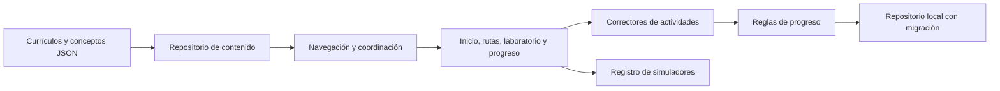

# Arquitectura

TeslaCode conserva una aplicación estática de módulos ES. El catálogo se carga al iniciar; las lecciones y simuladores, bajo demanda. Las herramientas de pruebas no son dependencias del navegador.

## Responsabilidades

- **Repository:** `content-repository.js` oculta fetch, cachea resultados y permite reintentar cargas fallidas. `core/storage.js` concentra persistencia, normalización y migración; puede sustituirse por un adaptador sincronizado.
- **Strategy:** `domain/grading.js` corrige selección, secuencias y respuestas abiertas normalizadas. Un nuevo tipo exige corrector, vista, validación y pruebas.
- **Registro de componentes:** `widgets/index.js` selecciona simuladores mediante identificadores y carga diferida.
- **Dominio puro:** `curriculum.js`, `progress.js`, `gamification.js` y `runner.js` no conocen el DOM. Se prueban con el runner de Node.
- **Presentación:** las vistas reciben estado y generan interfaz. `main.js` coordina navegación y persistencia mediante callbacks explícitos. No hace falta un bus de eventos mientras exista un solo coordinador de estas operaciones.

## Navegación y concurrencia

Las URLs por fragmento representan la vista, ruta, lección y etapa. Todos los accesos a una lección comprueban estado publicado y requisitos, incluso si se escribe la URL directamente. El token de render evita que una carga anterior reemplace una vista más reciente. Un cambio de ruta desmonta el contenido anterior completo.

Los requisitos son referencias de lección `ruta/id`, no coincidencias parciales de texto. El validador busca referencias inexistentes, ciclos y requisitos no publicados de lecciones publicadas. No se desbloquea saltando un tema todavía no redactado. Las lecciones ya completadas del formato anterior permanecen accesibles.

## Persistencia

La versión 2 mantiene XP, racha, finalizaciones, prácticas, recompensas concedidas, favoritos, último acceso y objetivo. Los últimos 20 intentos de cada lección permiten mostrar dificultades; la mejor puntuación permite reconocer avances anteriores. Las rachas usan el día local, no UTC.

La migración conserva los logros anteriores y no inventa resultados de preguntas. El progreso local es editable por su propietario: no constituye una certificación verificable. No almacena secretos ni llama a modelos remotos.

## Ejecución y texto

El intérprete educativo analiza una gramática limitada, sin `eval`, `Function`, acceso a red o bucles. Limita longitud, líneas, operaciones inválidas y resultados no finitos. La segmentación de texto no se presenta como tokenización comercial; la señal/ruido es una interpolación ilustrativa, no difusión neuronal.

El contenido HTML pertenece al repositorio y pasa por validación. El texto introducido por estudiantes, resultados de búsqueda y metadatos se escapan antes de insertarse como HTML. El validador no sustituye un sanitizador para un futuro editor público: ese producto requeriría otra frontera de confianza.

## Evolución

Una cuenta sincronizada, ejecución completa de lenguajes o integración con APIs requerirá servicios adicionales. Las credenciales de proveedores deben quedar en un servidor. La arquitectura actual permite agregar adaptadores sin mezclar contenidos con transporte o persistencia. No se introducen microservicios, estado global externo o un framework sin una necesidad comprobada.
